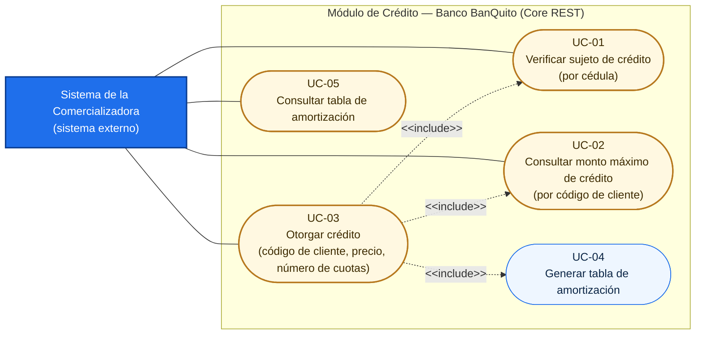
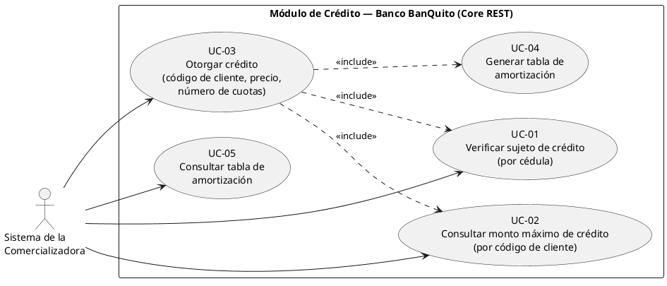

# 01 — Diagrama de Casos de Uso del Módulo de Crédito (Banco BanQuito)

**Rúbrica 1 — Diagrama de Casos de Uso del Módulo de Crédito del Banco BanQuito — 2.0 puntos.**

Este diagrama describe la frontera del **Módulo de Crédito del Banco BanQuito** (`banquito-core`).
El Core, por decisión del enunciado y del plan, **solo expone servicios web REST/JSON**: no tiene
interfaz de usuario. Por eso el actor del diagrama no es una persona sino el **Sistema de la
Comercializadora**, que es el sistema externo que invoca cada servicio.

## 1. Actor

| Actor | Tipo | Descripción |
|---|---|---|
| **Sistema de la Comercializadora** | Actor primario (sistema externo) | API NestJS de la comercializadora de teléfonos celulares (`comercializadora-api`). Es el único consumidor del módulo: consulta si el comprador es sujeto de crédito, cuánto crédito tiene aprobado, otorga el crédito y consulta la tabla de amortización para mostrarla en su propia aplicación. |

No hay actor humano en el diagrama porque el tribunal del banco no opera el Core: todo pasa por los
servicios REST. El vendedor de la comercializadora aparece recién en el
[diagrama de arquitectura](04-arquitectura.md), del lado de la comercializadora.

## 2. Casos de uso

| ID | Caso de uso | Parámetros de entrada | Servicio REST del Core | Rúbrica |
|---|---|---|---|---|
| UC-01 | Verificar sujeto de crédito | cédula | `GET /api/creditos/sujeto-credito?cedula={cedula}` | 5 (1.5) |
| UC-02 | Consultar monto máximo de crédito | código de cliente | `GET /api/creditos/monto-maximo/{codCliente}` | 6 (1.5) |
| UC-03 | Otorgar crédito | código de cliente, precio del teléfono, número de cuotas | `POST /api/creditos` | 7 (2.0) |
| UC-04 | Generar tabla de amortización | monto, número de cuotas, tasa anual | interno de UC-03 (`AmortizacionCalculator`) | 7 (2.0) |
| UC-05 | Consultar tabla de amortización | código de crédito | `GET /api/creditos/{codCredito}/amortizacion` | 10 (1.0) |

`UC-01` y `UC-02` son consultas independientes entre sí (la comercializadora las invoca en ese orden
al facturar con Crédito Directo), pero **UC-03 las incluye**: el Core no otorga un crédito sin volver a
verificar el sujeto de crédito y sin recalcular el monto máximo dentro de la misma transacción, de modo
que una llamada directa a `POST /api/creditos` no puede saltarse las reglas del banco.

## 3. Diagrama de casos de uso

Mermaid no tiene notación nativa de casos de uso UML, así que el diagrama se dibuja con `flowchart LR`
usando la convención UML: el **actor** como caja, cada **caso de uso** como elipse (nodo *stadium*) y las
dependencias `<<include>>` como flechas punteadas rotuladas (`&lt;&lt;include&gt;&gt;` en el código, que se
renderiza como `<<include>>`; los ángulos se escriben así para que el motor de Mermaid no los interprete
como etiquetas HTML). En la sección 4 está el mismo diagrama en PlantUML para las herramientas que sí
renderizan UML.

## 4. Equivalente en PlantUML

## 5. Justificación de las relaciones `<<include>>`

| Relación | Motivo |
|---|---|
| UC-03 → UC-01 | Otorgar el crédito exige volver a evaluar las cuatro reglas del sujeto de crédito (`evaluarReglas`) dentro de la misma transacción; si alguna falla, el Core responde `422 NO_ES_SUJETO_CREDITO` con los motivos y no escribe nada. |
| UC-03 → UC-02 | El monto máximo se recalcula al otorgar (`montoMaximo`) y el crédito se rechaza con `422 MONTO_EXCEDE_MAXIMO` si el precio supera ese monto; nunca se confía en el valor que la comercializadora consultó antes. |
| UC-03 → UC-04 | El crédito se persiste junto con su tabla de amortización en la misma transacción (`credito` + `tabla_amortizacion`); sin tabla no hay crédito. |

UC-04 no tiene actor propio: es un caso de uso incluido, no un servicio REST independiente.

## 6. Trazabilidad con los servicios implementados

| Caso de uso | Controlador / método | Regla funcional |
|---|---|---|
| UC-01 | `CreditoController.sujetoCredito` → `CreditoService.verificarSujetoCredito` | Reglas 1 a 4 del enunciado (ver [02](02-descripcion-caso-de-uso.md)) |
| UC-02 | `CreditoController.montoMaximo` → `CreditoService.calcularMontoMaximo` | `((promedio depósitos − promedio retiros) × 35%) × 6`, nunca menor a 0 |
| UC-03 | `CreditoController.otorgar` → `CreditoService.otorgarCredito` | Cuota fija, mensual, 3 a 18 cuotas, 16.5% anual |
| UC-04 | `AmortizacionCalculator.calcular` | `Cuota = P·i / (1 − (1+i)^−n)`, `TasaPeriodo = 16.5% / 12` |
| UC-05 | `CreditoController.amortizacion` → `CreditoService.obtenerCredito` | Devuelve el crédito con sus cuotas ordenadas por `num_cuota` |
