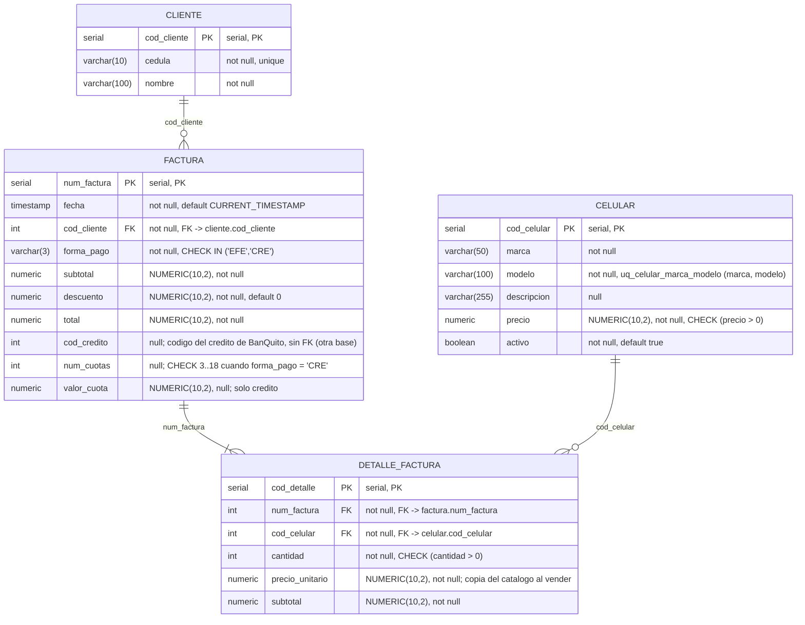
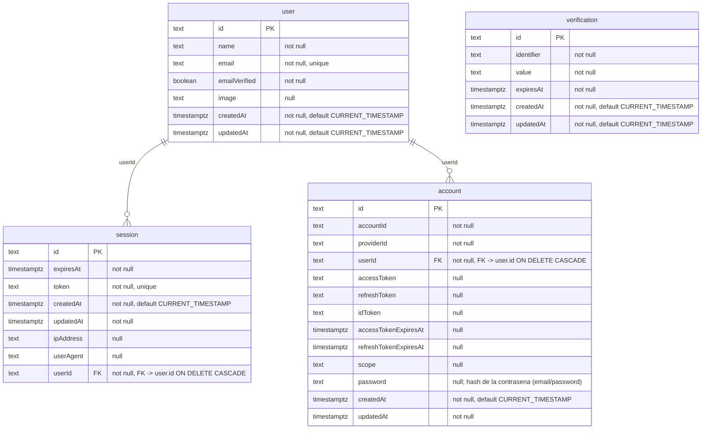
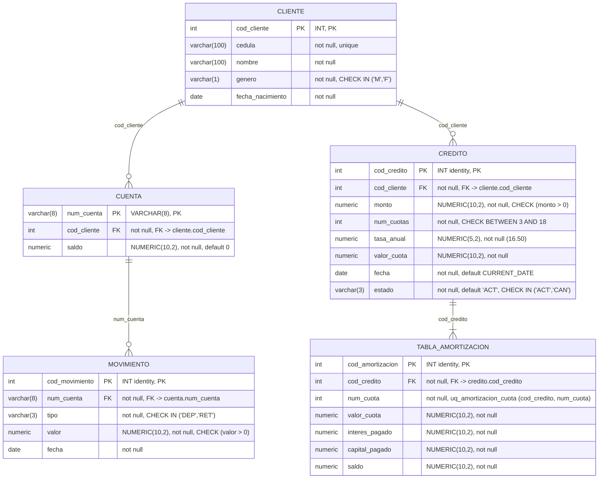

# 03 — Diagramas Entidad-Relación

Este documento cubre dos rúbricas:

| Rúbrica | Diagrama | Sección |
|---|---|---|
| **4** — Diagrama Entidad-Relación del Sistema de la Comercializadora (1.0 pto) | Base `comercializadora` + tablas de autenticación | 1 y 2 |
| **3** — Base de datos del sistema CORE (2.0 ptos) | Base `banquito`: modelo del enunciado + módulo de crédito | 3 |

Las dos bases viven en el **mismo contenedor PostgreSQL** (`postgres:17`, puerto 5432) pero son bases
separadas: la comercializadora **no tiene acceso SQL** a la base del banco; solo la consulta por sus
servicios REST. Por eso `factura.cod_credito` es un entero sin clave foránea hacia `banquito.credito`.

## 1. Diagrama ER — Sistema de la Comercializadora

Fuente exacta: `comercializadora-api/src/database/migrations/1793581116108-RetailerSchema.ts`
y las entidades de `comercializadora-api/src/{catalogo,facturacion}/*.entity.ts`.

Cardinalidades:

- `CLIENTE 1 — 0..N FACTURA`: un comprador puede tener varias facturas; una factura pertenece a un solo
  comprador. La comercializadora guarda su propia copia del cliente (cédula + nombre) para que la factura
  se pueda consultar sin depender del banco.
- `FACTURA 1 — 1..N DETALLE_FACTURA`: una factura siempre tiene al menos una línea de teléfono.
- `CELULAR 1 — 0..N DETALLE_FACTURA`: un teléfono puede venderse muchas veces. No hay inventario: el
  catálogo es la lista de equipos a la venta y el teléfono nunca se borra (`activo = false`), porque las
  facturas lo referencian.

### 1.1 Restricciones que dan forma al modelo

| Restricción | DDL | Efecto |
|---|---|---|
| `uq_celular_marca_modelo` | `unique (marca, modelo)` | Evita duplicar un teléfono en el catálogo (la API responde `409`). |
| `ck_factura_credito` | `(forma_pago = 'EFE' and cod_credito is null) or (forma_pago = 'CRE' and cod_credito is not null and num_cuotas between 3 and 18)` | Una factura en efectivo no puede llevar código de crédito, y una a crédito siempre lleva código de crédito del banco y un plazo entre 3 y 18 meses. |
| `celular.precio` / `detalle_factura.cantidad` | `CHECK (> 0)` | No existen precios ni cantidades negativas. |

### 1.2 Diccionario de datos

| Tabla | Columna | Tipo SQL | Nulo | Clave / Restricción |
|---|---|---|---|---|
| `celular` | `cod_celular` | `serial` | no | PK |
| | `marca` | `varchar(50)` | no | `uq_celular_marca_modelo` |
| | `modelo` | `varchar(100)` | no | `uq_celular_marca_modelo` |
| | `descripcion` | `varchar(255)` | sí | — |
| | `precio` | `numeric(10,2)` | no | `CHECK (precio > 0)` |
| | `activo` | `boolean` | no | `DEFAULT true` (borrado lógico) |
| `cliente` | `cod_cliente` | `serial` | no | PK |
| | `cedula` | `varchar(10)` | no | `UNIQUE` |
| | `nombre` | `varchar(100)` | no | — |
| `factura` | `num_factura` | `serial` | no | PK |
| | `fecha` | `timestamp` | no | `DEFAULT current_timestamp` |
| | `cod_cliente` | `int` | no | FK → `cliente.cod_cliente` |
| | `forma_pago` | `varchar(3)` | no | `CHECK IN ('EFE','CRE')` |
| | `subtotal` | `numeric(10,2)` | no | — |
| | `descuento` | `numeric(10,2)` | no | `DEFAULT 0` (42% del precio cuando es efectivo) |
| | `total` | `numeric(10,2)` | no | — |
| | `cod_credito` | `int` | sí | `ck_factura_credito`; **sin FK** (vive en otra base) |
| | `num_cuotas` | `int` | sí | `ck_factura_credito` (3 a 18 si es a crédito) |
| | `valor_cuota` | `numeric(10,2)` | sí | cuota fija devuelta por el banco |
| `detalle_factura` | `cod_detalle` | `serial` | no | PK |
| | `num_factura` | `int` | no | FK → `factura.num_factura` |
| | `cod_celular` | `int` | no | FK → `celular.cod_celular` |
| | `cantidad` | `int` | no | `CHECK (cantidad > 0)` |
| | `precio_unitario` | `numeric(10,2)` | no | precio congelado al momento de la venta |
| | `subtotal` | `numeric(10,2)` | no | `cantidad × precio_unitario` |

### 1.3 Datos sembrados

La migración inserta los seis teléfonos del catálogo del enunciado: Samsung Galaxy A16 (229.00),
Samsung Galaxy S25 (999.00), Apple iPhone 16 (1099.00), Xiaomi Redmi Note 14 (289.00),
Motorola Moto G85 (319.00) y Honor X8c (259.00). El catálogo es el único seed: `cliente`, `factura` y
`detalle_factura` empiezan vacías y se llenan con la facturación.

## 2. Tablas de autenticación (Better Auth)

Las crea la migración `1793580336123-AuthTables.ts` en la **misma base `comercializadora`**, con el DDL
que genera Better Auth para PostgreSQL. Son un bloque aparte: **no tienen relación con las tablas de
ventas** (la factura no registra qué usuario la emitió; la sesión solo protege el acceso a la aplicación
web y a los endpoints del API).

Índices: `session_userId_idx`, `account_userId_idx`, `verification_identifier_idx`.
`verification` no referencia a `user` en el esquema generado, por eso aparece sin relación.

## 3. Diagrama ER — Base de datos del CORE del Banco (`banquito`)

Fuente exacta: `banquito-core/src/main/resources/db/migration/V1__core_schema.sql` (esquema) y
`V2__core_seed.sql` (datos). Las tres primeras tablas son el modelo textual del enunciado; las dos
últimas son el módulo de crédito, creado **en el mismo esquema** como pide la consideración adicional 3.

Índice adicional: `ix_movimiento_cuenta_fecha (num_cuenta, fecha)`, que sostiene las consultas de las
reglas "depósito en el último mes" y "promedios de los últimos 3 meses".

### 3.1 Diccionario de datos del Core

| Tabla | Columna | Tipo SQL | Nulo | Clave / Restricción |
|---|---|---|---|---|
| `cliente` | `cod_cliente` | `int` | no | PK |
| | `cedula` | `varchar(100)` | no | `UNIQUE` |
| | `nombre` | `varchar(100)` | no | — |
| | `genero` | `varchar(1)` | no | `CHECK IN ('M','F')` |
| | `fecha_nacimiento` | `date` | no | — |
| `cuenta` | `num_cuenta` | `varchar(8)` | no | PK |
| | `cod_cliente` | `int` | no | FK → `cliente.cod_cliente` |
| | `saldo` | `numeric(10,2)` | no | `DEFAULT 0` |
| `movimiento` | `cod_movimiento` | `int` | no | PK, `GENERATED BY DEFAULT AS IDENTITY` |
| | `num_cuenta` | `varchar(8)` | no | FK → `cuenta.num_cuenta` |
| | `tipo` | `varchar(3)` | no | `CHECK IN ('DEP','RET')` |
| | `valor` | `numeric(10,2)` | no | `CHECK (valor > 0)` |
| | `fecha` | `date` | no | índice `ix_movimiento_cuenta_fecha` |
| `credito` | `cod_credito` | `int` | no | PK, identity |
| | `cod_cliente` | `int` | no | FK → `cliente.cod_cliente` |
| | `monto` | `numeric(10,2)` | no | `CHECK (monto > 0)` |
| | `num_cuotas` | `int` | no | `CHECK BETWEEN 3 AND 18` |
| | `tasa_anual` | `numeric(5,2)` | no | 16.50 (parámetro `banquito.credito.tasa-interes-anual`) |
| | `valor_cuota` | `numeric(10,2)` | no | cuota fija calculada |
| | `fecha` | `date` | no | `DEFAULT CURRENT_DATE` |
| | `estado` | `varchar(3)` | no | `DEFAULT 'ACT'`, `CHECK IN ('ACT','CAN')` |
| `tabla_amortizacion` | `cod_amortizacion` | `int` | no | PK, identity |
| | `cod_credito` | `int` | no | FK → `credito.cod_credito` |
| | `num_cuota` | `int` | no | `UNIQUE (cod_credito, num_cuota)` |
| | `valor_cuota` | `numeric(10,2)` | no | igual en todas las filas (cuota fija) |
| | `interes_pagado` | `numeric(10,2)` | no | `saldo_anterior × (16.5% / 12)` |
| | `capital_pagado` | `numeric(10,2)` | no | `valor_cuota − interes_pagado` |
| | `saldo` | `numeric(10,2)` | no | última cuota cierra en `0.00` |

### 3.2 Datos sembrados (rúbrica 3: al menos 5 clientes, 5 cuentas, 50 movimientos)

| Tabla | Filas | Detalle |
|---|---|---|
| `cliente` | 7 | 4 clientes que califican y 3 que fallan exactamente una regla (masculino menor de 25, sin depósito el último mes, crédito activo) |
| `cuenta` | 7 | una cuenta por cliente |
| `movimiento` | 52 | depósitos y retiros con fechas relativas a `CURRENT_DATE`, de modo que las reglas "último mes" y "últimos 3 meses" se cumplen el día de la demostración |
| `credito` | 1 | el crédito activo de Pedro Salazar (450.00, 6 cuotas, 16.50%), que es la tabla de ejemplo del enunciado |
| `tabla_amortizacion` | 6 | las seis cuotas de ese crédito, idénticas al ejemplo del PDF |
