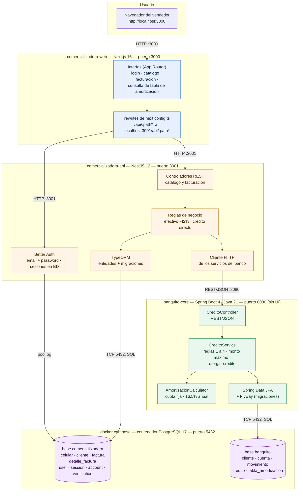
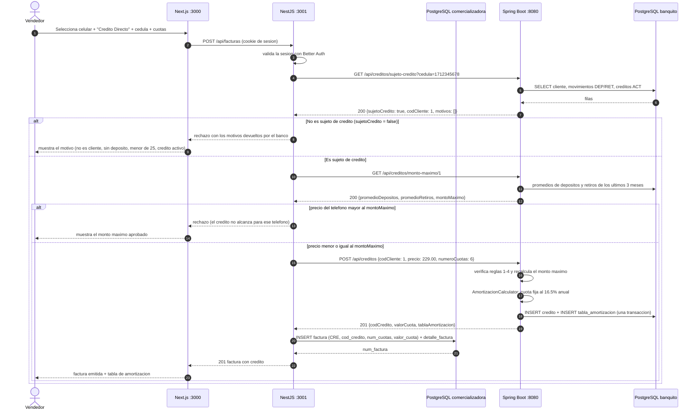
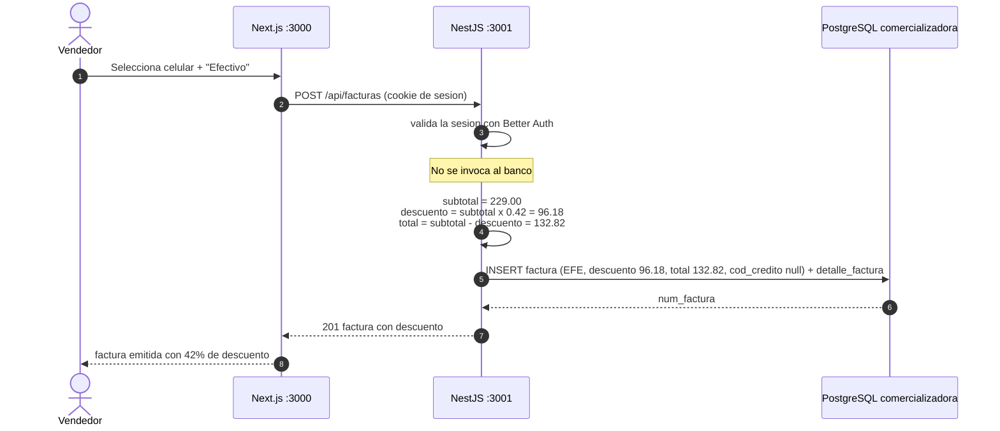

# 04 — Diagrama de Arquitectura de la Solución Completa

**Rúbrica 12 — Diagrama de Arquitectura de la solución completa — 1.0 punto.**

La solución son **dos aplicaciones web distintas** (consideración adicional 4 del enunciado):

1. **Módulo de Crédito del Banco BanQuito** (`banquito-core`): solo expone servicios web REST/JSON;
   no tiene interfaz gráfica.
2. **Sistema de la Comercializadora de Teléfonos Celulares** (`comercializadora-web` +
   `comercializadora-api`): es el cliente de esos servicios y el dueño de su propia base de datos.

## 1. Componentes y stacks

| Componente | Tecnología | Puerto | Responsabilidad |
|---|---|---|---|
| `comercializadora-web` | Next.js 16 (App Router), React 19 | **3000** | Interfaz del vendedor: catálogo de celulares, facturación (efectivo / crédito directo) y consulta de la tabla de amortización. Redirige `/api/*` al API (`rewrites`), así el navegador solo habla con `:3000` y las cookies de sesión pertenecen a ese origen. |
| `comercializadora-api` | NestJS 12, TypeORM, Better Auth, `pg` | **3001** | Único dueño de la base `comercializadora`. Valida la sesión en cada endpoint, aplica las reglas de facturación (descuento del 42% en efectivo) y llama por HTTP a los servicios del banco. |
| `banquito-core` | Spring Boot 4, Java 21, Spring Data JPA, Flyway, Validation | **8080** | Core bancario: aplica las cuatro reglas del sujeto de crédito, calcula el monto máximo, otorga el crédito con cuota fija al 16.5% anual y devuelve la tabla de amortización. Sin UI. |
| `postgres` | PostgreSQL 17 (`docker-compose.yml`) | **5432** | Un solo contenedor con **dos bases**: `banquito` (creada por el `POSTGRES_DB` del compose, esquema y datos por Flyway) y `comercializadora` (creada por el script de inicialización, esquema por migraciones de TypeORM). |

## 2. Diagrama de arquitectura



Reglas de la topología:

- La **comercializadora nunca abre una conexión a la base `banquito`**: el único camino hacia el banco
  es REST/JSON contra `:8080`. Por eso `factura.cod_credito` es un entero sin clave foránea.
- El **Core nunca escribe en la base `comercializadora`**: no sabe que existe.
- El navegador solo conoce el puerto 3000: Next.js reescribe `/api/*` hacia el API NestJS, y el API
  NestJS es el único que consume los servicios del banco.
- Las dos bases comparten contenedor y credenciales (`gr8` / `gr8pass`) pero **no esquema**: cada
  aplicación es dueña de la suya (`banquito` por Flyway, `comercializadora` por TypeORM).

## 3. Flujo de venta con Crédito Directo

El camino completo de la rúbrica 9 (facturación a crédito) y de la rúbrica 7 (otorgar el crédito).
La comercializadora expone `POST /api/facturas`; para una venta a crédito llama en orden a los
servicios del Core (`/api/creditos/...`) y solo guarda la factura cuando el banco otorgó el crédito.



Puntos que la defensa debe poder explicar:

- El Core **revalida** el sujeto de crédito y el monto máximo dentro de `POST /api/creditos`; la
  comercializadora no puede saltarse las reglas aunque llame directo al servicio.
- El crédito se crea **antes** de la factura, y la factura guarda su `cod_credito`: es la única forma de
  que la comercializadora pueda consultar después la tabla de amortización (rúbrica 11).
- Si la base de la comercializadora falla entre ambos pasos, el crédito queda otorgado sin factura: no
  hay transacción distribuida entre las dos bases, y el orden elegido (crédito primero) es el que pide
  el enunciado.

## 4. Flujo de venta en efectivo (descuento del 42%)



El descuento del 42% es una regla del servidor: el API NestJS calcula `subtotal`, `descuento` y `total`
al facturar (nunca el navegador), y la restricción `ck_factura_credito` de la base impide que una factura
en efectivo guarde un código de crédito del banco.

## 5. Servicios REST del Core (contrato que consume la comercializadora)

| Método | Ruta | Entrada | Respuesta | Errores | Rúbrica |
|---|---|---|---|---|---|
| `GET` | `/api/creditos/sujeto-credito?cedula={cedula}` | cédula | `200` `{cedula, codCliente, nombre, sujetoCredito, motivos[]}` | `400 SOLICITUD_INVALIDA` | 5 |
| `GET` | `/api/creditos/monto-maximo/{codCliente}` | código de cliente | `200` `{codCliente, promedioDepositos, promedioRetiros, montoMaximo}` | `404 CLIENTE_NO_ENCONTRADO` | 6 |
| `POST` | `/api/creditos` | `{codCliente, precio, numeroCuotas}` | `201` crédito con `tablaAmortizacion[]` | `400 CUOTAS_FUERA_DE_RANGO`, `400 SOLICITUD_INVALIDA`, `404 CLIENTE_NO_ENCONTRADO`, `422 NO_ES_SUJETO_CREDITO`, `422 MONTO_EXCEDE_MAXIMO` | 7 |
| `GET` | `/api/creditos/{codCredito}/amortizacion` | código de crédito | `200` crédito con `tablaAmortizacion[]` | `404 CREDITO_NO_ENCONTRADO` | 10 |

Todos los errores usan el mismo cuerpo: `{codigo, mensaje, motivos, montoMaximo}` (los dos últimos solo
cuando aplican).

## 6. Despliegue local

```bash
docker compose up -d                     # PostgreSQL 17 con las dos bases
cd banquito-core && ./mvnw spring-boot:run    # :8080, aplica Flyway V1 + V2
cd comercializadora-api && npm run start      # :3001, corre migraciones TypeORM
cd comercializadora-web && npm run dev        # :3000, interfaz
```

El esquema se versiona en dos lugares porque cada aplicación es dueña de su base:
`banquito-core/src/main/resources/db/migration/` (Flyway) y
`comercializadora-api/src/database/migrations/` (TypeORM). Ninguna aplicación usa `synchronize`/`ddl-auto`
para crear tablas.
